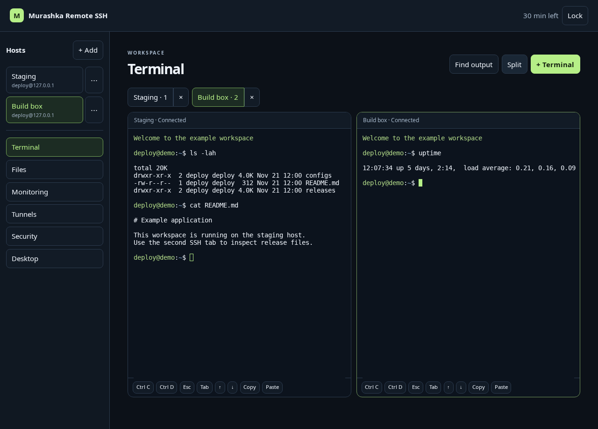
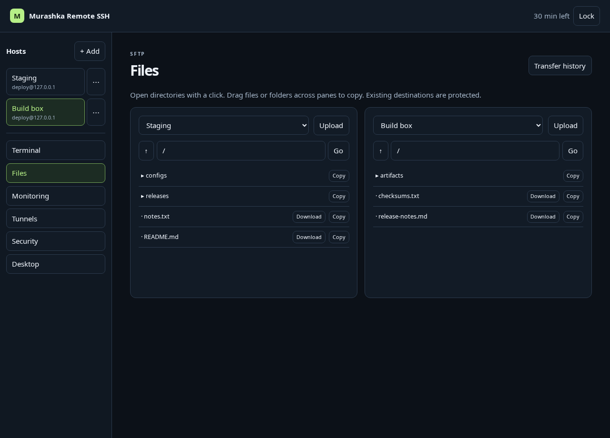
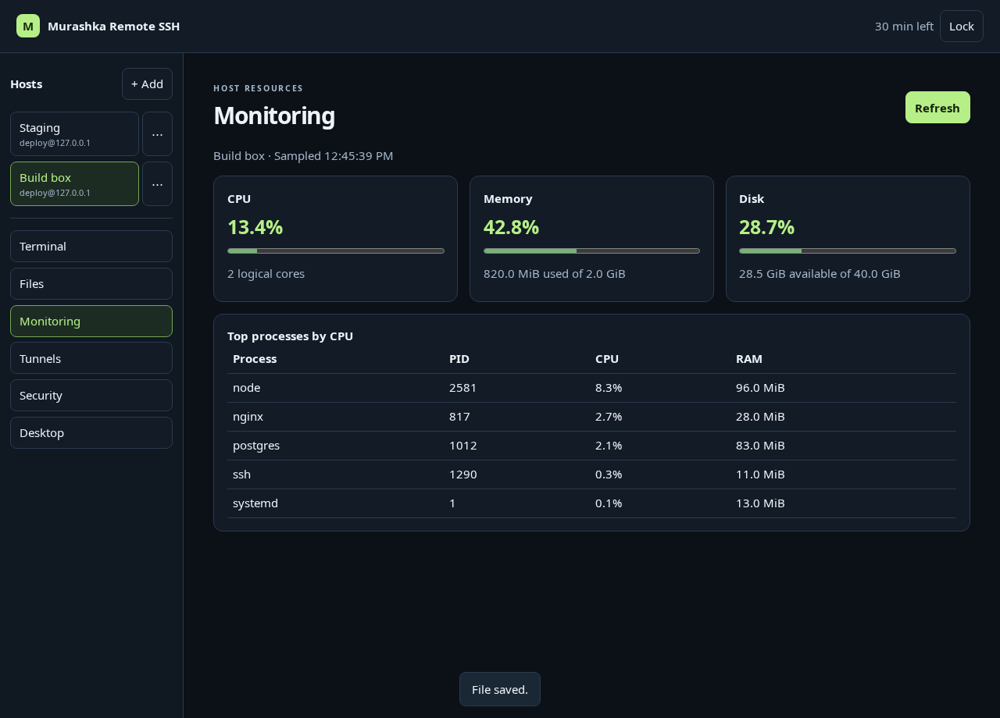
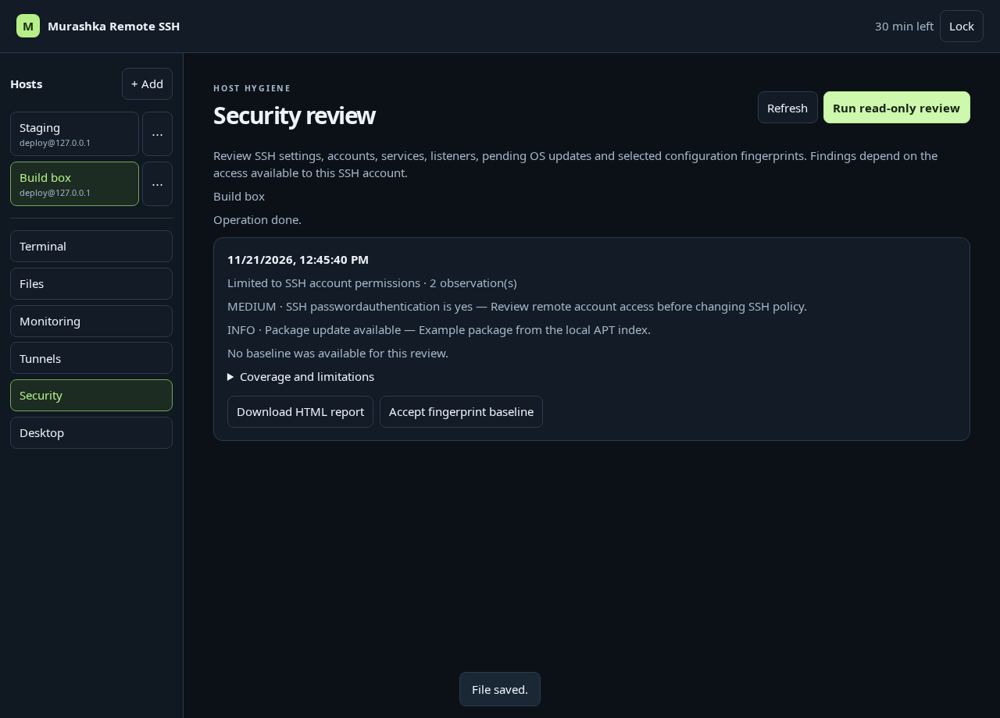
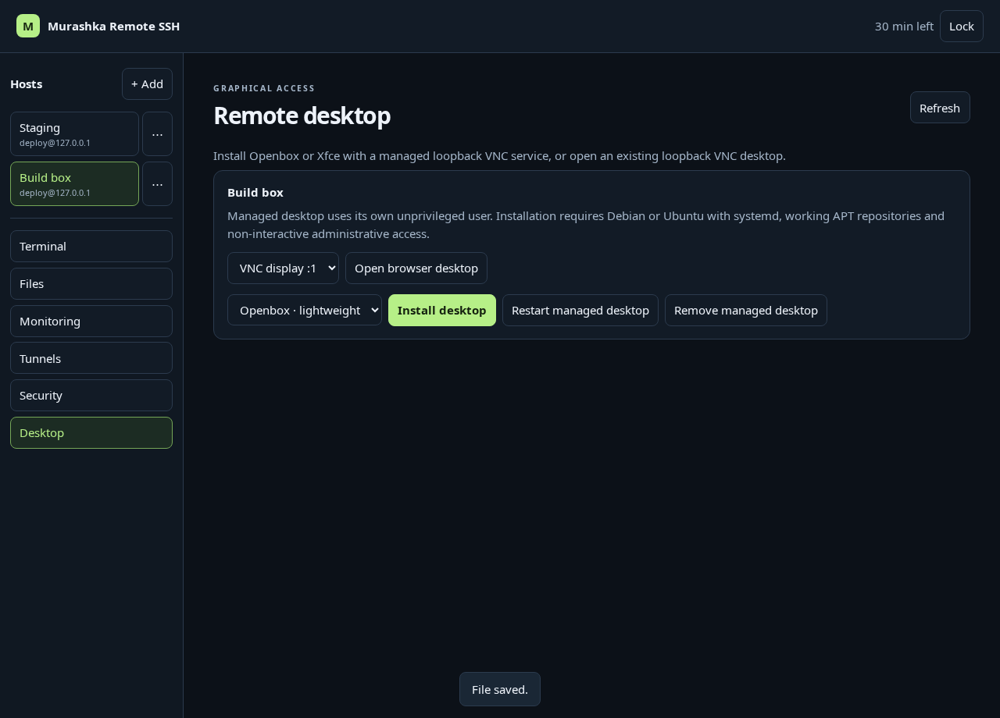
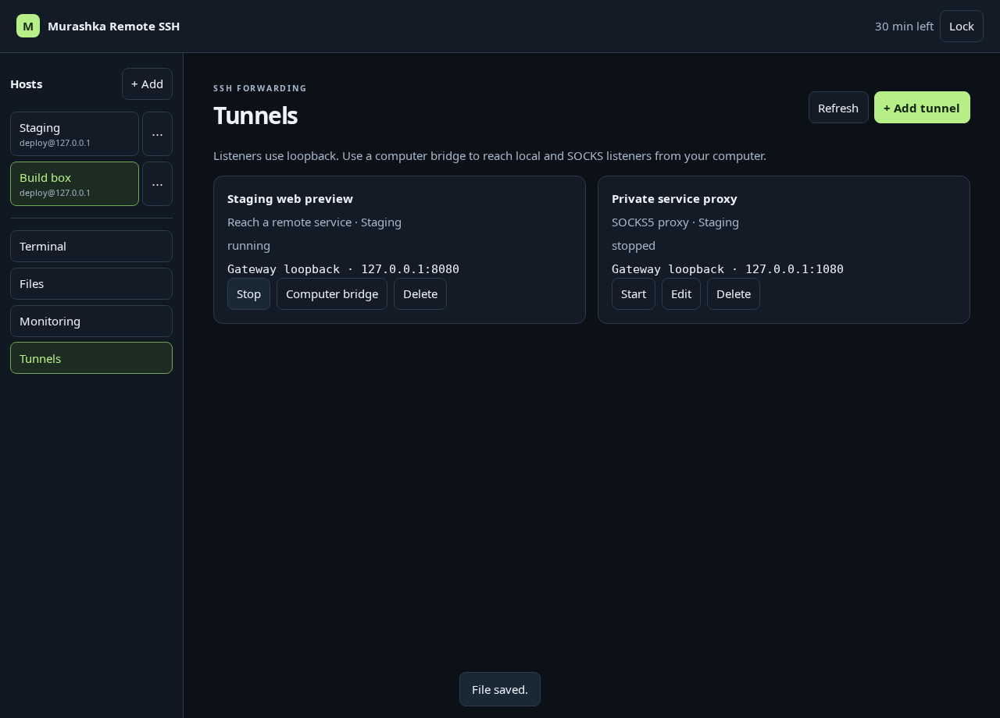

# Murashka Remote SSH

A self-hosted browser workspace for your SSH servers. Open independent terminals, move files between hosts, inspect resource usage, and manage SSH tunnels from one workspace.

[Project website](https://sm0k3net.github.io/murashka-remote-ssh/)

## What you can do

| Feature | Example |
| --- | --- |
| Browser SSH | Open a shell on your staging server and follow logs in a separate pane. Search terminal output and send common control keys from the toolbar. |
| Two-pane SFTP | Browse two directories side by side, edit UTF-8 files, upload or download a file, or drag files and folders between hosts. |
| Host monitoring | Pull CPU, memory, disk, and process statistics from a Linux host over the existing SSH connection. |
| SSH tunnels | Reach a private web application or database through a saved local tunnel, or use a SOCKS5 TCP listener. Reverse forwarding is available with an explicit server-side setting. |
| Telegram control | List hosts, inspect the latest sampled status, receive an expiring host-scoped link, and revoke bot-issued access from a private chat. |
| Security reviews | Inspect Linux accounts, listeners, services, SSH settings, APT update candidates and file fingerprints. Download an HTML report. |
| Remote desktops | Install Openbox or Xfce on a supported Debian or Ubuntu host and open the VNC session in your browser. |
| Temporary access | Issue a 30-minute, 2-hour, or 12-hour workspace link. Guest links grant shell and SFTP access to one saved SSH account. |

Murashka Remote SSH is intended for a single trusted operator and hosts they administer. The first release manages hosts the gateway can reach by SSH. Telegram is opt-in. The gateway and browser workspace work independently.

## Quick start

Use Python 3.12 or newer with venv support. The localhost evaluation also requires OpenSSL. On Ubuntu 24.04:

    sudo apt install git python3 python3-venv openssl
    git clone https://github.com/sm0k3net/murashka-remote-ssh.git
    cd murashka-remote-ssh
    ./setup.sh
    ./murashka init --local-tls
    ./murashka serve

In a second terminal in the same checkout, run:

    ./murashka grant

Open the complete URL it prints and enter the generated password. Use the locally generated certificate for this evaluation. Add an SSH host and compare the presented fingerprint with the fingerprint obtained directly from that host.

For installation on a remote server with a trusted certificate and an optional systemd user service, follow the [installation guide](docs/install.md).

## Screenshots

Screenshots use generated accounts, files, terminal output, and resource readings.

| Two-pane files | Monitoring |
| --- | --- |
|  |  |

| Security review | Remote desktop setup |
| --- | --- |
|  |  |

## Documentation

- [Telegram, security reviews and remote desktops](docs/host-operations.md)

- [Installation, HTTPS and upgrades](docs/install.md)
- [Usage examples and operational limits](docs/usage.md)
- [Changelog](CHANGELOG.md)
- [Security and private reporting](SECURITY.md)
- [Contributing and tests](CONTRIBUTING.md)
- [Third-party notices](THIRD_PARTY_NOTICES.md)

Project code is available under the [Apache License 2.0](LICENSE).
